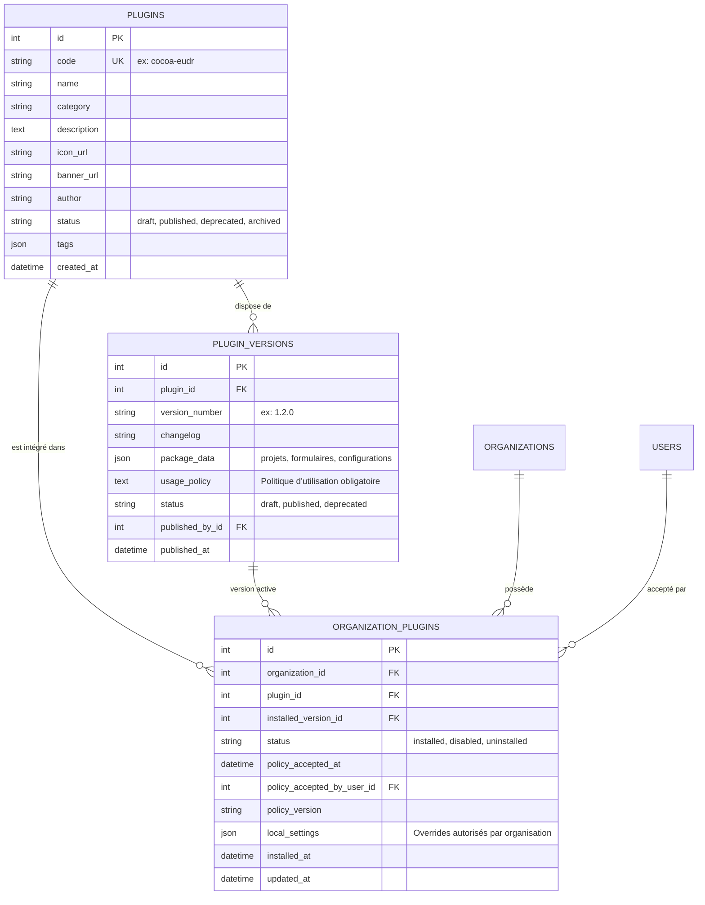
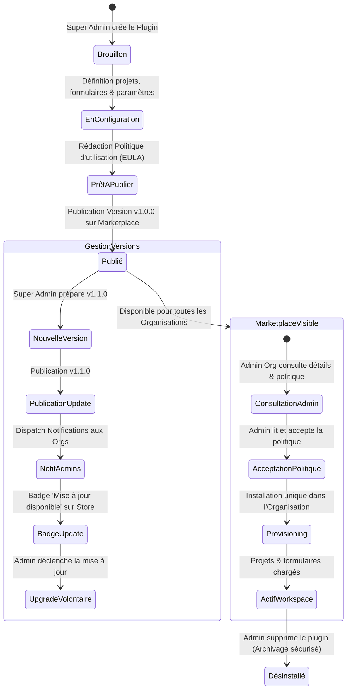

# SenWiseTool Plugin Lifecycle, Marketplace & Versioning Standard

Ce skill établit le **standard architectural, sécuritaire et opérationnel** gouvernant les **Plugins**, leur publication sur le **Marketplace**, leur distribution multi-tenant, et la gestion des **Versions non destructives** dans **SenWiseTool**.

---

## 1. Définition et Rôle des Plugins dans SenWiseTool

Un **Plugin** dans SenWiseTool est un **package modulaire et spécialisé** dédié à une filière, une thématique ou un standard opérationnel/réglementaire (ex. : *Traçabilité Cacao EUDR*, *Suivi Forestier & Déforestation*, *Hydrologie & Bassins Versants*, *Conformité ESG & Droits Humains*, *Santé & Sécurité Minière*).

### Le plugin embarque :
1. **Types de projets & Projets préconfigurés** : Modèles d'activités, jalons, indicateurs clés et règles de suivi.
2. **Formulaires de collecte terrain** : Schémas dynamiques de saisie (questions, types de données, géolocalisation, médias, contraintes de validation).
3. **Paramètres et préconfigurations** : Fréquences de synchronisation, règles de télémétrie IoT, webhooks, seuils d'alerte.
4. **Politique d'utilisation obligatoire (Usage Policy / EULA)** : Termes juridiques et réglementaires définis par le Super Admin, organisés et scellés pour chaque version, exigeant l'accord explicite de l'administrateur d'organisation avant intégration.

---

## 2. Principes Fondamentaux de Sécurité & Versioning (Les 6 Règles d'Or)

### Règle 1 : Immutabilité Stricte des Versions Publiées
- Une version publiée d'un plugin (ex. : `v1.0.0`) est **scellée et immuable**.
- Le Super Admin ne peut **jamais modifier rétroactivement** les éléments ou le schéma d'une version déjà publiée.
- Toute correction, ajout de champ, modification de formulaire ou de politique d'utilisation nécessite obligatoirement la création d'une **nouvelle version** (`v1.0.1`, `v1.1.0` ou `v2.0.0`).

### Règle 2 : Exécution Fixée par Tenant (Pinned Execution)
- Chaque organisation qui intègre un plugin est fixée sur sa **version installée** (`installed_version_id`).
- La publication d'une nouvelle version sur le Marketplace n'altère **jamais automatiquement** les projets, formulaires ou données en cours d'une organisation sans son action volontaire.
- Aucune régression ni rupture de schéma (breaking change) ne peut survenir à l'insu de l'administrateur d'organisation.

### Règle 3 : Installation Unique par Organisation
- Une organisation ne peut intégrer un même plugin qu'**une seule fois** (`UNIQUE(organization_id, plugin_id)` sur `organization_plugins`).
- Les statuts de l'intégration sont :
  - `installed` : Actif et opérationnel dans l'espace de travail.
  - `disabled` : Temporairement suspendu par l'administrateur.
  - `uninstalled` : Retiré de l'espace de travail.

### Règle 4 : Acceptation Obligatoire et Auditée de la Politique d'Utilisation
- Aucun plugin ne peut être téléchargé/installé sans acceptation explicite de la politique d'utilisation par l'administrateur de l'organisation.
- L'acceptation est enregistrée avec :
  - `policy_accepted_at` (horodatage UTC)
  - `policy_accepted_by_user_id` (identifiant de l'admin signataire)
  - `policy_version` (version de la politique acceptée)

### Règle 5 : Notification Automatique des Mises à Jour (Event-Driven)
- Dès que le Super Admin publie une nouvelle version d'un plugin :
  - Le Marketplace affiche le badge *"Mise à jour disponible"* avec le changelog détaillé.
  - Une notification in-app (`notification-management`) est automatiquement expédiée à tous les administrateurs des organisations utilisant ce plugin.

### Règle 6 : Mise à Jour Non Destructive & Désinstallation Sécurisée
- **Upgrade** : L'intégration d'une nouvelle version applique les ajouts sans écraser ni corrompre les données déjà collectées sur le terrain.
- **Uninstall** : La désinstallation d'un plugin retire l'accès opérationnel sans supprimer sauvagement l'historique de télémétrie ou de collecte (archivage conforme).

### Règle 7 : Unicité du Brouillon et Suppression Avant Publication
- Un plugin ne peut avoir **qu'une seule version en mode brouillon (`draft`)** à la fois.
- Tant qu'une version est en brouillon, il est formellement interdit d'en créer une nouvelle.
- **Suppression** : Une version non encore publiée peut être **librement supprimée**. En revanche, dès qu'une version est publiée (`published`), elle devient immuable et ne peut **jamais être supprimée directement**.

### Règle 8 : Spécification Exhaustive du Contenu à la Publication
- **Première version (`v1.0.0`)** : Lors de sa publication, le Super Admin doit obligatoirement détailler avec précision l'ensemble du contenu embarqué (modèles de projets, formulaires de collecte, paramètres IoT, connecteurs).
- **Versions ultérieures (`v1.1.0+`)** : Le Super Admin doit obligatoirement expliciter les nouveautés, correctifs, changements de comportement et instructions de transition dans le changelog.

### Règle 9 : Cycle de Dépréciation Planifiée, Rappels et Blocage EOL
- **Dépréciation formelle** : Le Super Admin peut déclarer une version publiée comme `deprecated` en fixant une **date d'échéance / fin de vie (EOL - End of Life)** configurable (ex : 30, 60, 90 jours ou date personnalisée) et un motif de dépréciation.
- **Signalement & Rappels automatiques** :
  - Un signalement visuel d'urgence (badge d'alerte avec compte à rebours de jours restants) s'affiche sur le Marketplace et dans l'espace des organisations concernées.
  - Des notifications in-app périodiques sont automatiquement envoyées aux administrateurs des organisations clientes pour les inciter à exporter leurs données et à basculer vers une version récente.
- **Blocage ferme à l'échéance EOL** : Une fois la date d'échéance EOL atteinte, la version dépréciée est **automatiquement verrouillée (`is_blocked: True`)** et n'est plus accessible ni exploitable pour les activités opérationnelles, protégeant ainsi l'intégrité de la plateforme.

### Règle 10 : Dépréciation Séquentielle et Unicité du Processus EOL
- **Unicité stricte du processus actif** : Un seul processus de dépréciation peut être en cours à la fois pour un même plugin. Tant que le compte à rebours de la version dépréciée n'est pas expiré et que celle-ci n'est pas définitivement bloquée et désactivée, **il est formellement interdit de déprécier une autre version**. L'objectif est d'éviter de lancer deux processus de migration concurrents à la fois.
- **Ordre d'ancienneté chronologique strict** : On ne peut déprécier que la version publiée **la plus ancienne** encore active (ordre chronologique `created_at` / SemVer). Il est interdit de sauter une version ou de déprécier une version plus récente avant la plus ancienne.
- **Présence obligatoire d'une version cible** : Il est interdit de déprécier l'unique version disponible d'un plugin. Le Super Admin doit obligatoirement avoir publié au préalable une version plus récente vers laquelle les organisations clientes pourront migrer.


---

## 3. Schéma Relationnel & Modélisation (SQLAlchemy)



---

## 4. Cycle de Vie d'un Plugin



---

## 5. Standard d'Implémentation Backend

### A. Modèle `OrganizationPlugin` (Contrainte d'Unicité)
```python
from sqlalchemy import Column, Integer, String, Boolean, DateTime, ForeignKey, JSON, Text, UniqueConstraint, func
from sqlalchemy.orm import relationship
from app.db.database import Base

class OrganizationPlugin(Base):
    __tablename__ = "organization_plugins"

    id = Column(Integer, primary_key=True, index=True)
    organization_id = Column(Integer, ForeignKey("organizations.id", ondelete="CASCADE"), nullable=False, index=True)
    plugin_id = Column(Integer, ForeignKey("plugins.id", ondelete="RESTRICT"), nullable=False, index=True)
    installed_version_id = Column(Integer, ForeignKey("plugin_versions.id", ondelete="RESTRICT"), nullable=False)

    status = Column(String(30), default="installed", nullable=False)  # installed, disabled, uninstalled

    # Traçabilité juridique de la politique d'utilisation
    policy_accepted_at = Column(DateTime(timezone=True), nullable=False)
    policy_accepted_by_user_id = Column(Integer, ForeignKey("users.id", ondelete="SET NULL"), nullable=True)
    policy_version = Column(String(50), nullable=False)

    # Paramètres locaux et configurations spécifiques à l'organisation
    local_settings = Column(JSON, nullable=True)

    installed_at = Column(DateTime(timezone=True), server_default=func.now(), nullable=False)
    updated_at = Column(DateTime(timezone=True), server_default=func.now(), onupdate=func.now(), nullable=False)

    # Contrainte absolue : 1 organisation ne peut intégrer un plugin qu'une seule fois
    __table_args__ = (
        UniqueConstraint("organization_id", "plugin_id", name="uq_organization_plugin"),
    )
```

### B. Notification Automatique lors de la Publication d'une Version
```python
async def publish_plugin_version(
    db: AsyncSession,
    plugin_id: int,
    version_id: int,
    publisher_user: User
) -> PluginVersion:
    # 1. Marquer la version comme publiée
    version = await _get_version(db, version_id)
    version.status = "published"
    version.published_at = datetime.now(timezone.utc)
    version.published_by_id = publisher_user.id
    
    # 2. Identifier toutes les organisations utilisant une version antérieure
    subscribers_res = await db.execute(
        select(OrganizationPlugin)
        .options(selectinload(OrganizationPlugin.organization))
        .where(
            OrganizationPlugin.plugin_id == plugin_id,
            OrganizationPlugin.status == "installed",
            OrganizationPlugin.installed_version_id != version.id
        )
    )
    installed_instances = subscribers_res.scalars().all()

    # 3. Dispatch de notification in-app aux administrateurs
    for inst in installed_instances:
        await notification_service.create_notification(
            db=db,
            user_id=inst.organization.owner_id,
            title=f"Mise à jour disponible : {version.plugin.name}",
            message=f"La version {version.version_number} est disponible sur le Marketplace. Consultez les nouveautés et mettez à jour votre espace.",
            link=f"/dashboard/marketplace/{version.plugin.code}",
            type="info"
        )

    await db.commit()
    return version
```

---

## 6. Standard d'Implémentation Frontend (Marketplace & Workspace)

### A. Badge et Détection de Mise à Jour
Dans le Marketplace ou la liste des plugins de l'organisation :
- Si `organizationPlugin == null` $\rightarrow$ Bouton **« Installer / Intégrer »**.
- Si `organizationPlugin != null && organizationPlugin.installed_version_id == plugin.latest_version_id` $\rightarrow$ Badge vert **« À jour (vX.Y.Z) »**.
- Si `organizationPlugin != null && organizationPlugin.installed_version_id != plugin.latest_version_id` $\rightarrow$ Badge ambre clignotant **« Mise à jour disponible (vA.B.C) »** + Bouton **« Mettre à niveau »**.

### B. Modale d'Acceptation de la Politique d'Utilisation
Avant le téléchargement, l'administrateur visualise une modale plein écran ou dédiée contenant :
1. Le résumé de la version et des composants intégrés (nouveaux projets, formulaires).
2. Le texte intégral de la **Politique d'Utilisation (EULA)** formaté en Markdown.
3. Une case à cocher obligatoire :  
   `[x] J'ai lu, compris et j'accepte sans réserve la politique d'utilisation du plugin pour mon organisation.`
4. Le bouton d'installation débloqué uniquement après acceptation.

---

## 7. Checklist d'Audit et de Conformité (10 Points)

Avant de déployer ou modifier toute fonctionnalité liée aux plugins :

1. [ ] **Unicité Tenant** : L'index unique `(organization_id, plugin_id)` empêche-t-il les doublons ?
2. [ ] **Immutabilité des versions** : Est-il impossible de modifier le JSON d'une version `published` ?
3. [ ] **Acceptation traçable** : L'ID de l'admin, la date et la version de politique sont-ils enregistrés ?
4. [ ] **Zéro rupture de données** : Les modifications d'une version n'altèrent-elles pas les données en cours des tenants ?
5. [ ] **Scoping strict** : Les projets générés par le plugin portent-ils bien l'`organization_id` de l'organisation installatrice ?
6. [ ] **Notifications ciblées** : Les admins des organisations utilisatrices sont-ils notifiés à chaque nouvelle version ?
7. [ ] **Bouton d'upgrade transparent** : L'admin peut-il consulter le changelog avant d'appliquer une mise à jour ?
8. [ ] **Désinstallation propre** : L'action de désinstallation archive-t-elle les composants sans écraser l'audit trail ?
9. [ ] **Contrôle d'accès Marketplace** : Seul le Super Admin peut créer/publier des plugins ; seul l'Admin d'organisation peut les intégrer.
10. [ ] **Gestion des dépendances** : Les formulaires et métriques du plugin sont-ils autonomes et compatibles avec les quotas de l'organisation ?
