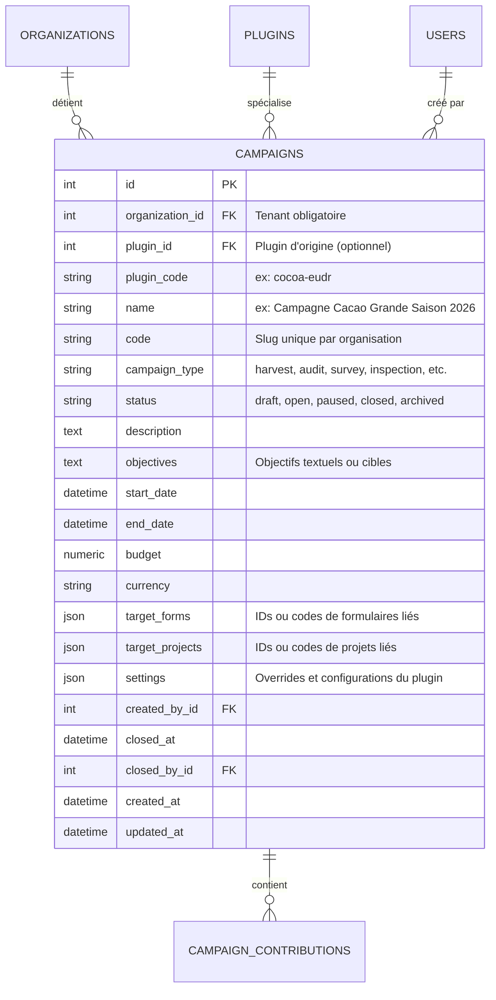
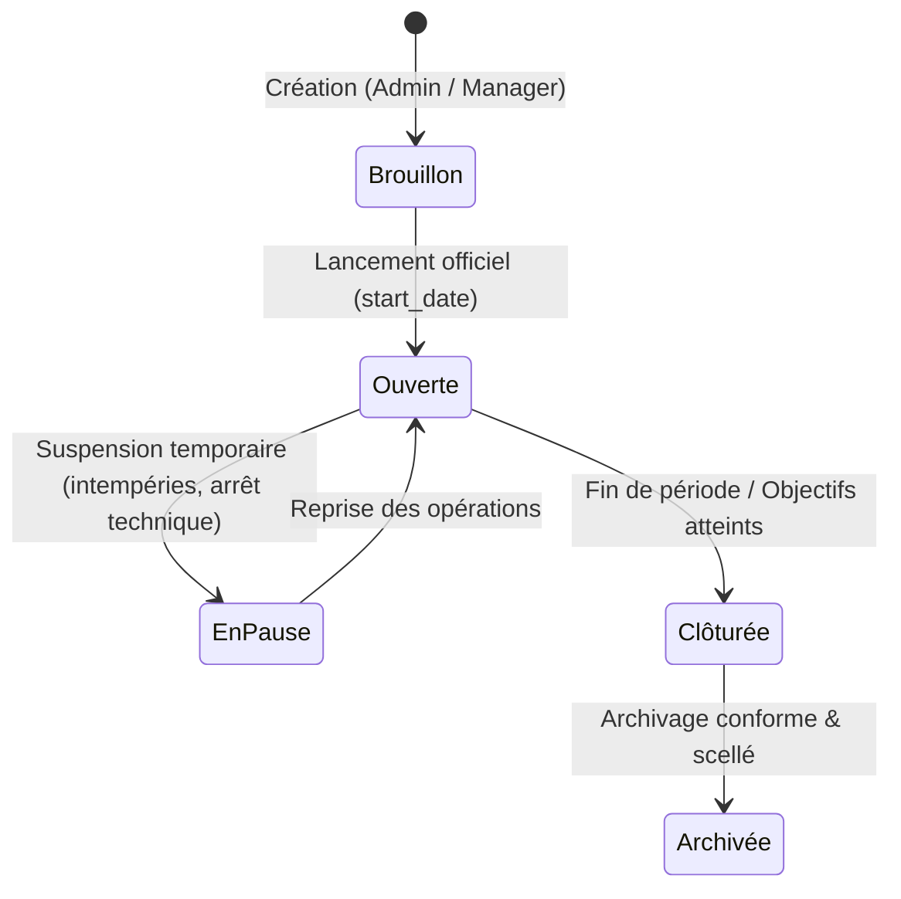

# SenWiseTool Plugin Tools & Modular Governance Standard

Ce skill établit le **standard architectural et opérationnel universel** pour la définition, la composition, la gouvernance des permissions et la spécialisation comportementale des **Outils (Tools / Modules fonctionnels)** intégrés dans les plugins de **SenWiseTool**.

---

## 1. Principes Fondamentaux de la Modulaire des Outils

### 1. Découplage et Autonomie des Outils
- Les outils sont des briques fonctionnelles **indépendantes et autonomes** (ex : Gestion des Campagnes, Moteurs de Formulaires, Télémétrie IoT, Cartographie SIG/GIS, Traçabilité QR/NFC, etc.).
- Un outil existe en tant qu'entité du registre universel des outils de la plateforme, avec ses propres modèles de données, ses endpoints d'API, ses capacités déclarées et son schéma de configuration par défaut.
- Un outil n'est pas codé en dur à l'intérieur d'un plugin unique : il est conçu pour être **composé et assemblé** selon les besoins dans un ou plusieurs plugins.

### 2. Composition Modulaire dans les Plugins
- Un plugin sélectionne et active un sous-ensemble d'outils via son package de version (`package_data["tools"]`).
- Lors de la publication du plugin, le Super Admin définit la liste des outils embarqués nécessaires pour la filière ou l'usage ciblé.
- Si un plugin n'inclut pas un outil donné, cet outil n'est pas exposé dans le contexte de ce plugin pour les organisations clientes.

### 3. Les 2 Modes de Déploiement et de Détention des Outils (Tool Distribution Modes)

Un outil intégré dans l'écosystème SenWiseTool opère selon l'un des deux modes stricts suivants :

1. **Mode A : Outil Indépendant & Souverain (`distribution_mode="tenant"`)**
   - **Créateur & Gestionnaire** : L'administrateur de l'organisation (`ADMIN_ORG` ou `MGR`).
   - **Autonomie Totale** : L'organisation crée, configure et gère ses propres ressources depuis zéro de façon 100% autonome dans son espace de travail.
   - **Isolation Souveraine** : Aucune ressource n'est pré-imposée, les données et configurations sont strictement étanches.

2. **Mode B : Ressources Pré-créées par le Super Admin (Éléments Spécifiques de Référence)**
   - **Créateur & Propriétaire Initial** : Le **Super Administrateur** de la plateforme, qui a configuré la ressource avec l'outil sur la plateforme (ex: une Campagne de référence ou une Ressource dynamique créée par le Super Admin).
   - **Sous-modes de Diffusion & Synchronisation** :
     - **B.1 Miroir Universel Centralisé (`distribution_mode="universal"`)** : La ressource est partagée telle quelle avec tous les abonnés du plugin. Si le Super Admin effectue une mise à jour (schéma, champs, validation), celle-ci est **automatiquement et immédiatement répercutée chez tous les utilisateurs du plugin**.
     - **B.2 Clone Dédié Local (`distribution_mode="tenant_clone"`)** : Une copie locale indépendante est générée pour chaque organisation lors de l'installation, gérée ensuite de façon étanche.
   - **Gouvernance Fine des Données & Droits Utilisateurs** :
     - **A. Données initiales embarquées (`include_initial_data`)** :
       - `true` : L'organisation intègre les données initiales déjà présentes dans la ressource du Super Admin (jalons, cibles, historique).
       - `false` : L'organisation démarre avec une ressource vierge de données.
     - **B. Droit de modification des données existantes (`allow_data_update`)** :
       - `true` : Les organisations peuvent éditer les enregistrements.
       - Portée des modifications (`data_update_scope`) :
         - `"centralized"` : Les modifications de tous les utilisateurs se font au même endroit et s'appliquent à tous les abonnés du plugin !
         - `"tenant_local"` : Les modifications restent privées et cloisonnées au tenant de l'organisation.
     - **C. Droit d'ajout de nouvelles données (`allow_data_addition`)** :
       - `false` (**Données scellées**) : L'organisation utilise uniquement les données définies par le Super Admin (lecture seule stricte).
       - `true` : L'organisation a le droit d'ajouter ses propres données à ce qui est déjà là.
     - **D. Régime de partage des données ajoutées (`data_addition_scope`)** :
       - `"shared"` (**Données Partagées / Mutualisées**) : Les données ajoutées par une organisation sont partagées entre tous les utilisateurs et organisations du plugin.
       - `"isolated"` (**Copie Indépendante**) : Chaque organisation gère ses données de façon isolée au sein de son tenant.
     - **E. Droit de suppression (`allow_data_deletion`)** et **Imports/Exports (`allow_import`, `allow_export`)**.
     - **F. Modification du schéma de données (`allow_schema_modification`)** :
       - Détermine si l'organisation peut modifier la structure même de la ressource (formulaires liés, champs, métriques) ou si la structure est verrouillée.
     - **G. Ergonomie du Right Drawer (Tiroir Latéral Droit)** :
       - Dès que le Super Admin clique sur « Ajouter » (que ce soit pour un outil global ou un élément spécifique), l'élément est directement injecté dans le package avec ses configurations par défaut et la **barre latérale droite s'ouvre automatiquement** pour permettre une personnalisation immédiate et fluide.

---

### 4. Spécialisation Comportementale selon le Plugin (Contextual Overrides)
- Un même outil peut adopter des **comportements distincts** selon le plugin dans lequel il est activé :
  - **Typologies de données spécifiques** : Par exemple, pour l'outil *Campagne*, un plugin « Cacao & Forêt EUDR » fournira des types de campagnes saisonnières (`harvest_main`, `harvest_mid`, `eudr_compliance_audit`) avec obligation de coordonnées polygonales GPS, tandis qu'un plugin « Mines & Sécurité » fournira des types de campagnes d'inspection périodique (`inspection_trimestrielle`, `controle_geotechnique`).
  - **Règles d'intégrité et validation** : Exigences de collecte, formulaires cibles prédéfinis, pièces justificatives obligatoires.
  - **Workflows et métriques** : Objectifs quantitatifs configurés selon la filière (tonnes métriques, hectares, effectif audité).

### 5. Ségrégation Stricte des Permissions : Restreintes vs. Partagées
Chaque outil définit une matrice de permissions claire :
- **Permissions Restreintes (Actions Administratives / Gouvernance)** :
  - Réservées exclusivement aux rôles d'autorité de l'organisation (`SUPER_ADMIN`, Propriétaire d'organisation, `ADMIN_ORG`, et `MGR` selon délégation).
  - Exemples : Création d'une campagne, modification des paramètres stratégiques, changement d'état du cycle de vie (ouverture, mise en pause, clôture définitive, archivage), suppression de données.
- **Permissions Partagées (Actions Opérationnelles & Collaboratives)** :
  - Accessibles aux membres opérationnels rattachés à l'organisation (`OPR` Opérateurs terrain, `AUD` Auditeurs, `ANL` Analystes, `LEC` Lecteurs).
  - Exemples : Consultation des campagnes en cours, participation aux missions de collecte, soumission de fiches terrain rattachées à la campagne active, consultation des tableaux de progression.

### 6. Cloisonnement Multi-Tenant Souverain
- Tout enregistrement créé par un outil (campagnes, sessions de collecte, mesures) est **strictement scellé à l'organisation légitime** (`organization_id`), sauf pour les outils déclarés explicitement en mode partagé (`is_shared=True`) dont l'accès est subordonné à l'installation active du plugin hôte.
- Un utilisateur ne peut en aucun cas interagir avec les outils ou les données d'une organisation tierce.
- Le backend vérifie systématiquement le rattachement de l'utilisateur et l'installation active du plugin dans son organisation.

---

## 2. Registre des Outils (Tool Registry Schema)

Chaque outil est enregistré avec une structure normalisée :

```json
{
  "code": "campaigns",
  "name": "Gestion des Campagnes",
  "category": "operations",
  "description": "Planification temporelle, objectifs de collecte, suivi d'avancement et encadrement des saisons opérationnelles.",
  "icon": "CalendarRange",
  "capabilities": [
    "lifecycle_management",
    "target_forms_binding",
    "target_projects_binding",
    "realtime_progress_tracking",
    "plugin_behavior_overrides"
  ],
  "permissions": {
    "restricted": [
      "campaigns:create",
      "campaigns:update_settings",
      "campaigns:change_status",
      "campaigns:delete",
      "campaigns:close"
    ],
    "shared": [
      "campaigns:view",
      "campaigns:participate",
      "campaigns:view_progress"
    ]
  },
  "default_config": {
    "allowed_statuses": ["draft", "open", "paused", "closed", "archived"],
    "require_dates": true,
    "allow_budget_tracking": true
  }
}
```

---

## 3. Premier Outil Concret : Gestion des Campagnes (`campaigns`)

### Modèle Relationnel de l'Outil Campagne



### Cycle de Vie d'une Campagne



### Règles de Gestion de l'Outil Campagne
1. **Unicité du Code par Organisation** : Le champ `code` (slug) doit être unique au sein de l'organisation (`organization_id`, `code`).
2. **Bornes Temporelles** : Si `end_date` est spécifiée, elle doit être postérieure à `start_date`.
3. **Statut 'open' conditionnel** : Seules les campagnes ayant le statut `open` acceptent la soumission de nouvelles données terrain de la part des opérateurs.
4. **Clôture et Immuabilité** : Une fois `closed` ou `archived`, les paramètres de la campagne et ses liaisons de formulaires deviennent verrouillés en lecture seule pour préserver la traçabilité d'audit.
5. **Suppression protégée** : Seule une campagne au statut `draft` sans aucune contribution enregistrée peut être supprimée. Une campagne ayant été ouverte ou clôturée ne peut qu'être archivée.

---

## 4. Matrice des Rôles & Accès sur l'Outil Campagne

| Rôle | Voir la liste | Voir les détails / KPIs | Créer une campagne | Modifier les paramètres | Changer le statut (Ouvrir / Clôturer) | Supprimer (Brouillon) |
| :--- | :---: | :---: | :---: | :---: | :---: | :---: |
| **SUPER_ADMIN** | ✅ | ✅ | ✅ | ✅ | ✅ | ✅ |
| **Propriétaire Admin** | ✅ | ✅ | ✅ | ✅ | ✅ | ✅ |
| **Administrateur (`ADM`)** | ✅ | ✅ | ✅ | ✅ | ✅ | ✅ |
| **Manager Projet (`MGR`)** | ✅ | ✅ | ✅ | ✅ | ✅ | ❌ |
| **Opérateur (`OPR`)** | ✅ (Actives) | ✅ (Basique) | ❌ | ❌ | ❌ | ❌ |
| **Auditeur (`AUD`)** | ✅ | ✅ (Audit) | ❌ | ❌ | ❌ | ❌ |
| **Analyste (`ANL`)** | ✅ | ✅ (Analytics) | ❌ | ❌ | ❌ | ❌ |
| **Lecteur (`LEC`)** | ✅ | ✅ (Lecture seule)| ❌ | ❌ | ❌ | ❌ |

---

---

## 5. Checklist de Validation pour Tout Nouvel Outil

Avant de valider l'intégration d'un outil dans SenWiseTool, vérifier :
- [ ] L'outil dispose d'un identifiant unique (slug) et d'un contrat de configuration indépendant.
- [ ] Le modèle de données applique strictement `organization_id` avec clé étrangère et index de performance.
- [ ] Les surcharges de comportement spécifiques au plugin sont isolées dans un champ `settings` JSON ou table dédiée.
- [ ] La ségrégation des permissions (Restricted vs Shared) est vérifiée au niveau de la couche Service & Endpoints.
- [ ] La suppression physique est interdite dès que des données opérationnelles sont enregistrées (passage en archivage).
- [ ] Des tests unitaires et d'intégration couvrent l'isolation des données, le cycle de vie et le contrôle d'accès RBAC.

---

## 6. Workflow de Build du Plugin & Espace de Travail de Version

Les outils ne sont jamais placés en dur dans la barre latérale standard d'une organisation. Ils sont **composés et configurés dans le package de la version du plugin** par le Super Admin :

1. **Accès Dédié à la Version (`/dashboard/plugins/[pluginId]/versions/[versionId]`)** :
   Chaque version d'un plugin dispose d'un espace de travail complet accessible directement depuis le Studio Plugins. Le Super Admin peut y inspecter le package, composer les outils et suivre le statut de cycle de vie.

2. **RÈGLE FONDAMENTALE : Travail Exclusif sur les Versions en Brouillon (`draft`)** :
   - **Mode Brouillon (`status == 'draft'`)** :
     - C'est l'**unique mode modifiable**. Le Super Admin peut librement ajouter des outils du catalogue, modifier leurs paramètres (modes souverain/partagé/préconfiguré), configurer les champs immuables, supprimer des outils ou mettre à jour le changelog et la politique.
     - L'API `PUT /api/v1/plugins/{plugin_id}/versions/{version_id}` accepte les modifications uniquement si le statut est `draft`.
   - **Mode Publié & Scellé (`status == 'published'`)** :
     - **Immuabilité Absolue (Règle 1)** : Dès qu'une version est publiée sur le Marketplace, elle est **définitivement scellée**. Aucune modification, ajout ou suppression d'outil n'est plus autorisée (l'API rejette toute tentative avec une erreur HTTP 400).
     - Cela garantit la non-régression, la conformité réglementaire et la stabilité juridique pour toutes les organisations abonnées.
     - Pour apporter une modification, une correction ou un nouvel outil, le Super Admin doit obligatoirement **créer une nouvelle version SemVer en brouillon** (ex: `v1.1.0`).

3. **Catalogue Central des Outils (`/api/v1/plugins/tools/catalog`)** :
   Expose l'ensemble des modules disponibles sur la plateforme (`campaigns`, `forms`, `iot_telemetry`), leurs capacités, et leurs paramètres par défaut.

4. **Composition des Outils dans le Package (`package_data["tools"]`)** :
   - Mode de détention (`tenant` [Mode A], `plugin_shared` [Mode B]).
   - Liaison de ressource Super Admin (`selected_resource_id`, `selected_resource_name`, `selected_resource_data`).
   - Gouvernance des données (`include_initial_data`, `allow_data_addition`, `data_sharing_scope`, `allow_schema_modification`).
   - Matrice de permissions (`restricted` pour admins/managers vs `shared` pour opérateurs/auditeurs).
   - Politique d'immuabilité (`is_immutable=True` avec sélection granulaire des `immutable_fields`).

5. **Règle d'Exclusion des Ressources en Brouillon (`status != 'draft'`)** :
   - En **Mode B**, les ressources au statut `draft` (brouillon) ne sont **JAMAIS** chargées ni éligibles au partage dans un plugin.
   - Une ressource doit être validée et active (`open`, `paused`, `closed`, ou `archived`) pour être liée à un plugin.

6. **Navigation Modulaire & Outils Actifs** :
   - **Catalogue des Outils Actifs** : Seuls les outils activement construits et disponibles (`is_available == True`, actuellement `campaigns`) sont proposés dans "Ajouter un Outil au Plugin".
   - **Menu Latéral "Outils"** : Dans la barre latérale du Super Admin, les outils de gouvernance sont regroupés sous une entrée parente extensible **"Outils"**, contenant leurs instances respectives (ex: `Campagnes`).
