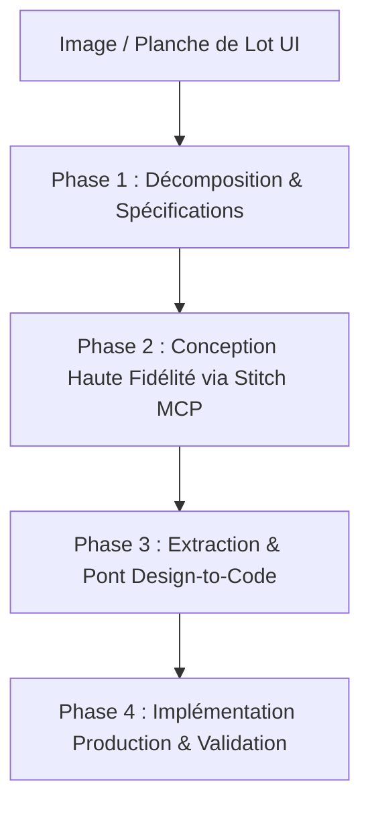

# Stitch Board to Code — Guide Opérationnel

Ce guide établit le standard d'ingénierie pour transformer une planche de spécifications UI d'architecture (lots multi-écrans, light/dark mode, wizards, tables analytiques, états variants) en interfaces de production fidèles, modulaires et testées dans SenWiseTool.

---

## Architecture du Workflow en 4 Phases

---

## Phase 1 : Décomposition & Spécifications du Lot

Avant tout appel d'outil ou écriture de code :
1. **Inventaire exhaustif des écrans** :
   - Identifier chaque identifiant d'écran (ex. `ADM-03 Console liste`, `ADM-04 Demande de création Wizard`, `ADM-05 Types & prérequis`, `ADM-06 Détail organisation`, `ADM-15 Connecteurs`, `ADM-16 Audit plateforme`).
2. **Identification des variantes d'états (Panel 7)** :
   - Écran de chargement (`Loading` avec spinner/skeleton)
   - Écran vide (`Empty State` avec illustration et call-to-action)
   - Erreur / Accès refusé (`Access Denied / 403` avec cadenas)
   - Confirmation destructive (`Confirmation` modal rouge)
   - Mode hors-ligne (`Offline banner/pill`)
   - Conflit de données (`Data Conflict`)
   - Maintenance en cours (`Maintenance mode`)
3. **Parité Light Mode / Dark Mode** :
   - Chaque écran doit disposer d'un contraste conforme WCAG 2.2 AA.
   - Light mode : fonds blancs purs `#FFFFFF`, cartes gris très clair `#F8FAFC`, bordures `#E2E8F0`, textes ardoise `#0F172A`.
   - Dark mode : fonds abysses `#041329` / `#07192C`, cartes `#0D1C32` / `#112036`, bordures `white/10`, textes `#D6E3FF` / `#F8FAFC`.
   - Accents : Vert Émeraude bioluminescent `#00A86B` / `#10B981`, Cyan atmosphérique `#38BDF8`, Ambre `#F59E0B`, Rouge écarlate `#EF4444`.

---

## Phase 2 : Conception Haute Fidélité via Stitch MCP

1. **Gestion du Projet Stitch** :
   - Vérifier les projets existants avec `list_projects`.
   - Créer un projet dédié au Lot via `create_project(title: "SenWiseTool - Lot XX ...")`.
   - Utiliser ou réutiliser le Design System officiel SenWiseTool (*Bio-Precision Telemetry*, asset `assets/51347c44cc1c473498250a595a3a0408` ou équivalent).
2. **Génération d'écrans (`generate_screen_from_text`)** :
   - Fournir des prompts ultra-descriptifs incluant :
     - Rôle utilisateur (Super Administrateur, Opérateur, etc.)
     - Disposition géométrique (Sidebar fixe 280px, Navbar 80px avec recherche globale et profil)
     - Zone d'actions dynamiques de la Navbar (boutons primaires, actions groupées)
     - Cartes KPIs analytiques avec compteurs et variations
     - Tableaux de données complets (colonnes précises, badges de statuts colorés, actions contextuelles)
     - Formulaires / Wizards multi-étapes (stepper numéroté, champs requis, boutons Suivant/Retour)
   - Paramètres stricts :
     - `projectId` : ID du projet Stitch sans préfixe
     - `deviceType` : `"DESKTOP"` (ou `"MOBILE"` si planche mobile)
     - `designSystem` : ID du design system du projet pour garantir la continuité visuelle.
3. **Génération des variantes (`generate_variants`)** :
   - Créer les variantes Dark/Light et les états particuliers requis (chargement, erreur, modale de confirmation).

---

## Phase 3 : Extraction & Pont Design-to-Code

1. **Récupération des spécifications (`get_screen`)** :
   - Extraire le HTML/JSX, les classes Tailwind, les structures de cartes et d'icônes Lucide correspondantes.
2. **Mapping dans l'architecture Next.js App Router** :
   - Ne jamais ré-implémenter la Sidebar ou la Navbar dans les pages : elles sont partagées par [`dashboard/layout.tsx`](file:///Users/jlove/Documents/projects/Senima%20Company/SWT%20ORGANIZATION/applications/web/src/app/%5Blocale%5D/dashboard/layout.tsx).
   - Chaque sous-vue (`/dashboard/organizations`, `/dashboard/organizations/new`, `/dashboard/organizations/[id]`, etc.) se concentre uniquement sur son `<main>` et injecte ses actions de Navbar via `useSetDashboardActions`.
3. **Séparation Stricte Logique / Vue** :
   - Pas de logique métier complexe ni d'appels API directs dans le JSX des composants.
   - Toute la logique (sélection, pagination, filtrage, wizard, soumission) réside dans des hooks personnalisés (`useOrganizations`, `useCreateOrganizationWizard`, `useOrganizationTypes`, etc.).

---

## Phase 4 : Implémentation Production & Validation

1. **Conformité aux Boucliers de Chargement (`view-state-and-loaders`)** :
   - Boutons désactivés (`disabled={isSubmitting || isOperating}`) pendant toute action asynchrone.
   - Libération garantie via `try ... finally { setIsLoading(false); }`.
   - Spinners visuels à l'intérieur des boutons d'action.
   - Modales accessibles au clavier (touche Échap, focus trap, aria-labels).
2. **Internationalisation Complète (i18n)** :
   - Ajouter systématiquement tous les textes dans `messages/fr.json` et `messages/en.json`.
3. **Assurance Qualité** :
   - Valider la compilation stricte : `npx tsc --noEmit`.
   - Valider le build de production : `npm run build` (0 warning, 0 erreur).
   - Valider le bon comportement visuel en mode clair et en mode sombre.
